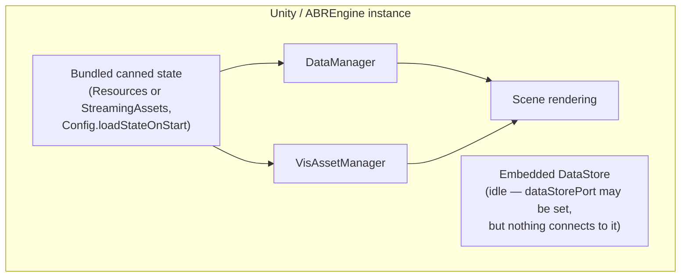
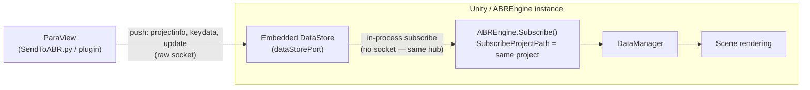
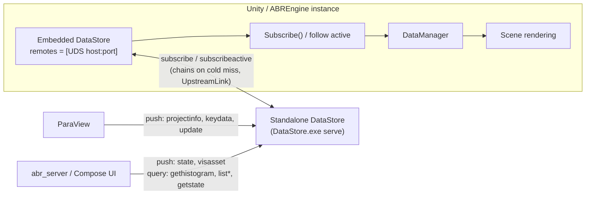
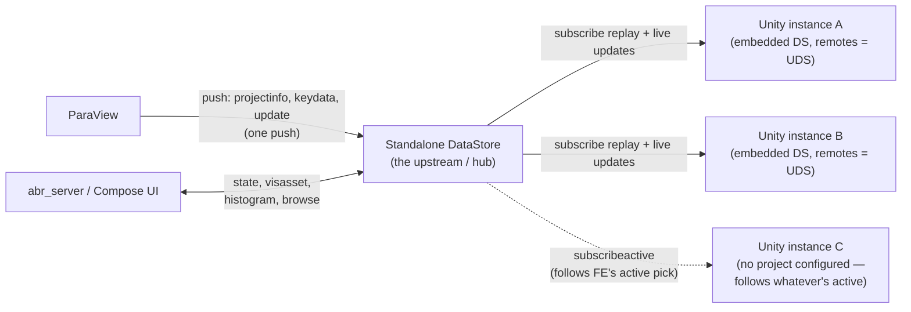

# ABR DataStore: Data Movement Architecture

This document describes how data, styling, VisAssets, and derived queries
(like histograms) move between ParaView, the DataStore broker, Unity/
ABREngine instances, and the Compose web UI (`abr_server`, referred to below
as "the FE"). It covers four base topologies and how they combine into a
real multi-client deployment.

## The building blocks

- **ParaView** — the ultimate data producer. Pushes raw scientific data
  (`KeyData`) and project bounds (`ProjectInfo`) over a length-prefixed
  socket protocol (`Tools/SendToABR.py`, or the ParaView plugin). It never
  reads anything back — pure producer.
- **DataStore node** — a broker that persists what's pushed to it and fans
  it out to subscribers. **The exact same code** (`DataStoreServer`,
  `SubscriptionHub`, `FilesystemProjectStore`) runs in two forms:
  - **Standalone** — `DataStore.exe serve <port> <mediaRoot>`, a plain
    console process.
  - **Embedded** — inside a running Unity/ABREngine instance, started
    automatically when `dataStorePort` is set in config.

  A DataStore node can optionally have one **upstream** (`remotes`/
  `RemoteEndpoint`) — another DataStore node it lazily chains to on a local
  cache miss. Ingestion (accepting a push) and upstream-chaining (fetching
  from your own upstream) are independent — a node can do both at once.
- **Unity / ABREngine instance** — a consumer (renders KeyData + applies
  State), and optionally *also* a broker if it embeds its own DataStore
  node.
- **The FE (`abr_server` / Compose UI)** — a consumer and producer of
  styling: browses projects/states/VisAssets, pushes edited `State` and
  locally-authored `VisAsset`s, requests histograms, and can designate a
  project+state as the DataStore's **active** one so a Unity instance with
  no project of its own configured can follow along automatically.

## Protocol tags at a glance

| Tag | Direction | Purpose |
|---|---|---|
| `projectinfo`, `keydata`, `update` | producer → node | ParaView's raw push protocol (also accepted from anything else) |
| `state`, `visasset` | FE → node | Push edited styling / a locally-authored VisAsset |
| `subscribe` | consumer → node | Long-lived: full replay of one project, then live updates |
| `subscribeactive` | consumer → node | Long-lived: follow whatever project+state is currently "active", even if it changes |
| `listprojects`, `liststates`, `listkeydata`, `listvisassets` | consumer → node | One-shot browse queries |
| `getstate`, `getvisasset`, `gethistogram` | consumer → node | One-shot fetch of a single item / computed result |
| `setactive`, `attachfe` | FE → node | Designate the active project+state; renew the "only one FE" lease |

Every node — standalone or embedded — understands all of these identically.

---

## A) Unity app, standalone

No ParaView, no upstream, no FE. The embedded DataStore (if enabled at all)
just sits idle — nothing pushes to it and nothing chains through it. The app
falls back to whatever canned state is bundled with the build.

`Subscribe()` finds `SubscribeProjectPath` empty and nothing "active" (no
upstream to chain to), so it falls through to
`LoadCannedStateFallback()` — the same bundled-state path `Awake()` also
runs unconditionally at startup regardless of subscription outcome.

---

## B) Unity app + ParaView, standalone (no upstream, no FE)

ParaView pushes straight into *this instance's own* embedded DataStore. The
same instance also subscribes to that same project on its own embedded
node — no separate process involved.

**Gotcha**: `Subscribe()` doesn't retry. If Unity subscribes *before*
ParaView has pushed anything, the subscribe fails once (project not found,
no upstream to chain to) and won't auto-recover when the data later
arrives — call `Subscribe()` again after ParaView's first push. Also note
ParaView only pushes `KeyData`/`ProjectInfo` — no `State` — so without a
bundled canned state (still applied unconditionally at the end of
`Awake()`) or a state pushed some other way, geometry renders unstyled.

---

## C) Unity app with an upstream DataStore

A standalone DataStore process is the hub. Unity's embedded node is
configured with `remotes` pointing at it and has no local copy of anything
— every request chains upstream on first miss (`EnsureAvailableAsync` /
`EnsureActiveAvailableAsync`) and caches locally from then on.

Nothing has to be configured on `UDS`'s side for this to work — a downstream
node chaining to it is indistinguishable from any other subscriber. The FE
talks to `UDS` too, so state edits and locally-authored VisAssets pushed
from Compose become visible to Unity through the exact same chain.

---

## D) ParaView feeding an upstream DataStore (multi-client fan-out)

The other half of (C) — showing why a standalone hub exists at all. One
ParaView push reaches every subscribed client without ParaView knowing or
caring how many there are.

This is the actual production shape: ParaView and the FE both feed one
standalone hub, and any number of Unity/headset clients subscribe to it —
either to an explicit project (A, B), or to whatever the FE has marked
**active** (C), which transparently re-points them if the FE opens a
different project later, no reconnect needed.

---

## VisAssets and histograms move differently than KeyData/State

The four diagrams above focus on KeyData/State/active, which are all
**push + subscribe** (a producer pushes, subscribers get a live replay
stream). VisAssets and histograms use the other two request styles instead:

- **VisAssets** are global and UUID-keyed (not project-scoped, unlike
  KeyData/State) and treated as immutable once a UUID exists, so there's no
  live subscription for them — just `visasset` (push), `listvisassets`
  (browse), and `getvisasset` (fetch one bundle), each a one-shot round
  trip. A node that doesn't have a requested UUID locally pulls it from its
  upstream on demand and caches it — the same cold-miss chaining as
  projects, just keyed differently. This is how a locally-authored colormap
  created in Compose (`abr_server`'s `save_from_local`) reaches a Unity
  client that never talked to the FE directly: FE pushes it to `UDS`
  (scenario C/D), Unity's `DataStoreVisAssetFetcher` pulls it from `UDS` the
  first time a state references that UUID.
- **Histograms** are computed on request, not stored at all —
  `gethistogram` reads a KeyData binary the node already has locally
  (chaining upstream first if needed, same as any other query) and returns
  the computed result directly; nothing is cached or replayed. This is what
  lets the FE avoid ever touching KeyData binaries on disk itself.

## Two mechanisms worth understanding separately from the diagrams

**Cold-subscribe chaining** (`EnsureAvailableAsync`): a node always checks
its own local store first; it only reaches out to its configured upstream
when something is genuinely missing. Ingestion (accepting a push) never
consults the upstream at all — the two paths are fully independent, which
is why a node can simultaneously ingest directly from ParaView *and* chain
to its own upstream for other projects (scenario B and C's mechanisms can
coexist on one node).

**The "active" lease** (`setactive` / `attachfe`): a single, node-wide
pointer (not per-project) that only an FE can set, gated by a renewable
15-second lease so two FEs can't fight over it. `SubscribeActive` is how a
Unity instance with *no project of its own configured* finds out what to
show — and it keeps following live if the FE switches projects, without the
Unity side ever re-subscribing.
